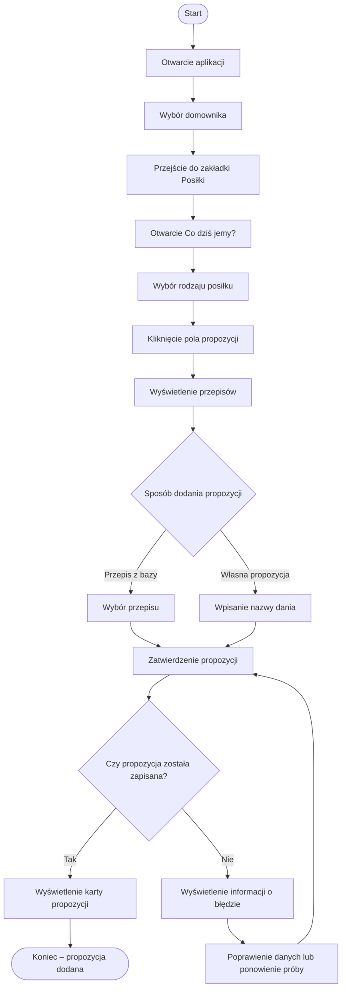
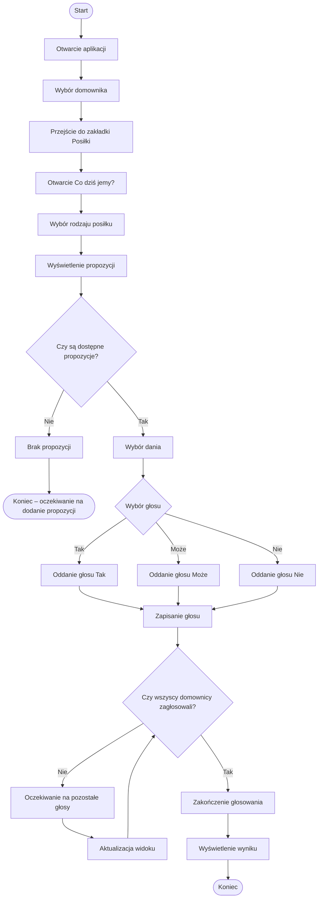

# User Flows – Hungrycator

## 1. Cel dokumentu

Celem dokumentu jest przedstawienie przepływów użytkownika (User Flows) w aplikacji Hungrycator.

User Flow przedstawia kolejne czynności wykonywane przez użytkownika, decyzje podejmowane podczas korzystania z aplikacji oraz reakcje systemu na poszczególne działania.

Diagramy zostały przygotowane na podstawie funkcjonalności proponowania posiłków i głosowania opisanej w historii użytkownika S-02.

Dokument uwzględnia:
- główną ścieżkę użytkownika,
- alternatywne ścieżki działania,
- punkty decyzyjne,
- sytuacje błędne,
- zakończenia sukcesem,
- stany ładowania i puste stany.

---

# 2. User Flow – Dodawanie propozycji posiłku

## Cel

Umożliwienie domownikowi dodania propozycji posiłku poprzez wybranie przepisu z bazy lub wpisanie własnej nazwy dania.

## Aktor

Domownik.

## Przebieg procesu

1. Użytkownik otwiera aplikację Hungrycator.
2. Wybiera swojego domownika za pomocą paska „Jesteś:”.
3. Przechodzi do zakładki Posiłki.
4. Otwiera ekran „Co dziś jemy?”.
5. Wybiera rodzaj posiłku: śniadanie, obiad lub kolację.
6. Klika pole propozycji.
7. System udostępnia przepisy z bazy.
8. Użytkownik decyduje, czy wybiera przepis z bazy, czy wpisuje własną propozycję.
9. Po wybraniu lub wpisaniu dania użytkownik zatwierdza propozycję.
10. System zapisuje propozycję i wyświetla ją na liście.
11. Pozostali domownicy mogą zobaczyć dodane danie.

## Diagram User Flow – Dodawanie propozycji

---

# 3. User Flow – Głosowanie na propozycję posiłku

## Cel

Umożliwienie domownikom wyrażenia opinii na temat zaproponowanego dania poprzez wybór jednej z trzech opcji: Tak, Może lub Nie.

## Aktor

Domownik.

## Przebieg procesu

1. Użytkownik otwiera aplikację Hungrycator.
2. Wybiera swojego domownika.
3. Przechodzi do zakładki Posiłki.
4. Otwiera ekran „Co dziś jemy?”.
5. Wybiera rodzaj posiłku.
6. Przegląda dostępne propozycje.
7. Wybiera interesującą go propozycję.
8. Oddaje głos, wybierając Tak, Może lub Nie.
9. System zapisuje głos.
10. System aktualizuje informacje o głosowaniu.
11. Użytkownik oczekuje na głosy pozostałych domowników.
12. Po oddaniu głosów przez wszystkich domowników głosowanie zostaje zakończone.
13. System przedstawia wynik głosowania.

## Diagram User Flow – Głosowanie

---

# 4. Alternatywne ścieżki i sytuacje wyjątkowe

Podczas korzystania z aplikacji mogą wystąpić sytuacje, w których użytkownik nie może przejść standardową ścieżką.

| Sytuacja | Reakcja systemu | Możliwe działanie użytkownika |
|---|---|---|
| Brak dostępnych przepisów | Wyświetlenie pustej listy przepisów. | Wpisanie własnej propozycji. |
| Brak propozycji posiłków | Wyświetlenie pustego widoku. | Dodanie nowej propozycji lub oczekiwanie. |
| Niepoprawne dane propozycji | Wyświetlenie informacji o błędzie. | Poprawienie danych i ponowienie próby. |
| Problem z zapisaniem propozycji | Poinformowanie użytkownika o niepowodzeniu operacji. | Ponowienie próby. |
| Brak wszystkich głosów | Głosowanie pozostaje w toku. | Oczekiwanie na pozostałych domowników. |
| Brak połączenia z serwerem | Wyświetlenie informacji o problemie z połączeniem. | Ponowienie operacji po przywróceniu połączenia. |

Uwaga: powyższe sytuacje błędne i reakcje interfejsu opisują oczekiwane zachowanie projektowe. Nie wszystkie komunikaty i widoki błędów są potwierdzone w obecnej implementacji.

---

# 5. Stany systemu

W trakcie korzystania z aplikacji należy uwzględnić różne stany interfejsu.

### 5.1. Stan ładowania (Loading State)

Występuje podczas pobierania danych z serwera, np. listy przepisów lub propozycji posiłków.

Oczekiwane zachowanie:
- wyświetlenie informacji o ładowaniu,
- zablokowanie ponownego wysłania tej samej operacji do czasu jej zakończenia,
- pokazanie pobranych danych po zakończeniu operacji.

### 5.2. Stan pusty (Empty State)

Występuje, gdy nie ma jeszcze żadnych propozycji posiłków lub dostępnych danych do wyświetlenia.

Oczekiwane zachowanie:
- wyświetlenie informacji o braku propozycji,
- umożliwienie użytkownikowi dodania nowego dania,
- zachęcenie do skorzystania z dostępnych funkcji aplikacji.

### 5.3. Stan błędu (Error State)

Występuje, gdy system nie może wykonać żądanej operacji.

Oczekiwane zachowanie:
- wyświetlenie komunikatu o błędzie,
- poinformowanie użytkownika o niepowodzeniu operacji,
- umożliwienie ponowienia działania.

### 5.4. Stan sukcesu (Success State)

Występuje, gdy operacja zostanie wykonana poprawnie.

Przykłady:
- dodanie nowej propozycji,
- zapisanie głosu,
- zakończenie głosowania.

Oczekiwane zachowanie:
- aktualizacja widoku,
- wyświetlenie nowych danych,
- poinformowanie użytkownika o powodzeniu operacji.

---

# 6. Powiązanie User Flows z funkcjonalnościami Hungrycatora

| User Flow | Powiązana funkcjonalność | Historia użytkownika |
|---|---|---|
| Dodawanie propozycji posiłku | Wybór przepisu lub dodanie własnego dania | S-02 |
| Głosowanie na posiłek | Oddawanie głosów Tak / Może / Nie | S-02 |
| Aktualizacja głosowania | Synchronizacja danych pomiędzy domownikami | S-02 |

---

# 7. Podsumowanie

Przygotowane diagramy User Flows przedstawiają najważniejsze ścieżki użytkowników podczas korzystania z funkcji proponowania posiłków i głosowania.

Pierwszy diagram opisuje proces dodawania propozycji, uwzględniając możliwość wyboru przepisu z bazy lub wpisania własnego dania.

Drugi diagram przedstawia proces głosowania, w którym domownicy mogą wyrazić swoją opinię poprzez wybór jednej z trzech dostępnych odpowiedzi.

Uwzględnienie alternatywnych ścieżek, punktów decyzyjnych oraz stanów systemu pozwala lepiej zrozumieć sposób działania aplikacji i stanowi podstawę do dalszego projektowania oraz weryfikacji interfejsu Hungrycatora.
