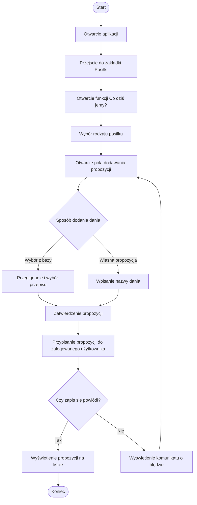
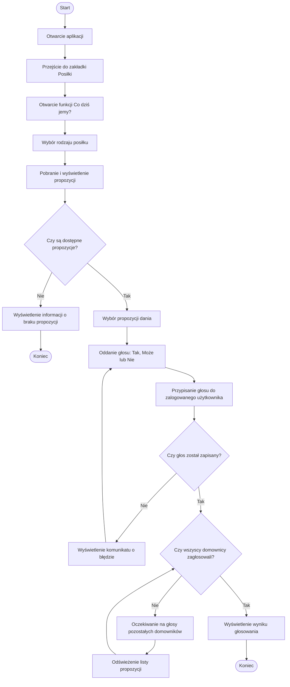

# User Flows – Hungrycator

## 1. Cel

Celem diagramów User Flow jest przedstawienie kolejnych kroków, które użytkownik wykonuje podczas korzystania z funkcji „Co dziś jemy?” w aplikacji Hungrycator.

Diagramy przedstawiają dwa główne procesy:
- dodawanie propozycji posiłku;
- głosowanie nad propozycjami posiłków.

Użytkownik korzystający z aplikacji jest wcześniej zalogowany na swoje konto. System automatycznie rozpoznaje jego tożsamość, dlatego nie musi on wybierać domownika przed rozpoczęciem działania.

---

## 2. User Flow – dodawanie propozycji posiłku

### Opis procesu

Użytkownik otwiera aplikację Hungrycator i przechodzi do zakładki „Posiłki”. Następnie wybiera funkcję „Co dziś jemy?” oraz rodzaj posiłku, którego dotyczy propozycja.

Może wybrać przepis z dostępnej bazy lub wpisać własną propozycję. Po zatwierdzeniu system zapisuje propozycję i przypisuje ją do zalogowanego użytkownika.

Jeżeli zapis się powiedzie, propozycja zostaje wyświetlona na liście. W przypadku błędu użytkownik otrzymuje odpowiedni komunikat i może ponowić próbę.

### Diagram

### Alternatywne ścieżki i sytuacje wyjątkowe

- **Wybór przepisu z bazy** – użytkownik przegląda dostępne przepisy i wybiera interesującą go propozycję.
- **Dodanie własnego dania** – użytkownik wpisuje nazwę posiłku, którego nie ma w bazie przepisów.
- **Błąd zapisu** – system wyświetla komunikat o niepowodzeniu i umożliwia ponowienie próby.
- **Brak dostępnych przepisów** – użytkownik może skorzystać z możliwości wpisania własnej propozycji, jeśli jest ona dostępna.

### Stany interfejsu

- **Loading:** oczekiwanie na załadowanie dostępnych przepisów lub zapisanie propozycji.
- **Empty:** brak dostępnych przepisów lub propozycji.
- **Error:** nie udało się pobrać danych albo zapisać propozycji.
- **Success:** propozycja została poprawnie dodana i pojawia się na liście.

---

## 3. User Flow – głosowanie nad propozycją posiłku

### Opis procesu

Użytkownik otwiera aplikację Hungrycator i przechodzi do zakładki „Posiłki”, a następnie wybiera funkcję „Co dziś jemy?”. Po wybraniu rodzaju posiłku wyświetla się lista dostępnych propozycji.

Użytkownik wybiera interesujące go danie i oddaje głos, wybierając jedną z trzech opcji: „Tak”, „Może” lub „Nie”.

System zapisuje głos i przypisuje go do zalogowanego użytkownika. Następnie sprawdza, czy wszyscy domownicy oddali już swoje głosy. Jeżeli nie, lista propozycji jest odświeżana, a użytkownicy mogą oczekiwać na pozostałe głosy. Po oddaniu głosów przez wszystkich domowników system przedstawia wynik głosowania.

### Diagram

### Alternatywne ścieżki i sytuacje wyjątkowe

- **Brak propozycji** – system wyświetla informację o braku dostępnych dań.
- **Błąd zapisu głosu** – użytkownik otrzymuje komunikat o błędzie i może ponowić próbę.
- **Pozostali domownicy jeszcze nie zagłosowali** – system oczekuje na ich głosy i odświeża dane.
- **Wszyscy domownicy zagłosowali** – system przedstawia wynik głosowania.

### Stany interfejsu

- **Loading:** oczekiwanie na pobranie listy propozycji lub zapisanie głosu.
- **Empty:** brak propozycji do głosowania.
- **Error:** nie udało się pobrać propozycji lub zapisać głosu.
- **Success:** głos został zapisany, a po zakończeniu głosowania wyświetlany jest jego wynik.

---

## 4. Powiązanie User Flow z makietami Figma

Diagramy User Flow powinny odpowiadać ekranom i elementom interfejsu przedstawionym w projekcie Figma.

| Element User Flow | Odpowiadający ekran lub element w Figmie |
|---|---|
| Otwarcie aplikacji | Ekran główny aplikacji |
| Przejście do zakładki „Posiłki” | Zakładka „Posiłki” |
| Otwarcie „Co dziś jemy?” | Ekran funkcji wyboru posiłku |
| Wybór rodzaju posiłku | Element wyboru śniadania, obiadu lub kolacji |
| Dodawanie propozycji | Pole lub ekran dodawania dania |
| Przeglądanie przepisów | Lista dostępnych przepisów |
| Wyświetlenie propozycji | Lista dodanych propozycji |
| Oddanie głosu | Przyciski „Tak”, „Może” i „Nie” |
| Wyświetlenie wyniku | Ekran lub element prezentujący wynik głosowania |

**Uwaga:** ostateczne nazwy ekranów i elementów należy dopasować do rzeczywistych makiet w Figmie. Jeżeli dany ekran lub stan nie został zaprojektowany, należy oznaczyć go jako brakujący element do uzupełnienia.

---

## 5. Podsumowanie

Przedstawione User Flows pokazują dwa podstawowe sposoby korzystania z funkcji „Co dziś jemy?” – dodawanie własnych propozycji oraz głosowanie nad propozycjami innych domowników.

Oba procesy rozpoczynają się od otwarcia aplikacji przez zalogowanego użytkownika. System automatycznie rozpoznaje jego konto i przypisuje do niego wykonywane działania.

Diagramy uwzględniają również alternatywne ścieżki, sytuacje błędów oraz stany interfejsu, dzięki czemu przedstawiają nie tylko podstawowy przebieg procesu, ale także możliwe sytuacje wyjątkowe.
